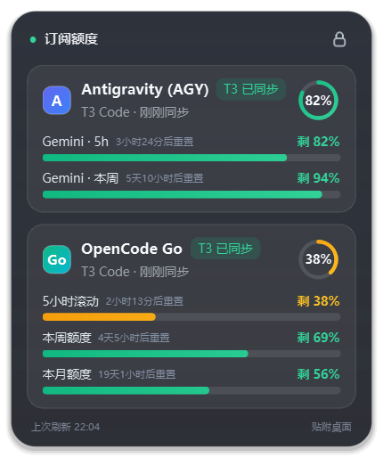
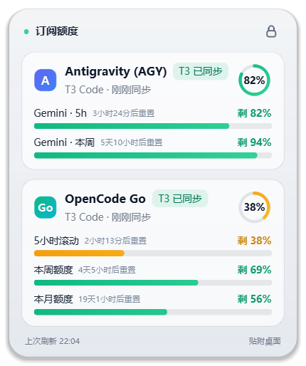

# Quota Desktop Widget（订阅额度桌面小组件）

一个仿 macOS / iOS 风格的 **Windows 独立桌面小组件**（Python + PySide6），贴附在桌面上实时展示 **Antigravity (AGY)** 和 **OpenCode Go** 的订阅剩余额度与重置倒计时。

<p align="center">
  
  &nbsp;&nbsp;&nbsp;
  
</p>

## 核心特性

- **极简桌面交互**：桌面卡片上**仅保留右上角 1 个锁定/解锁按钮**（解锁时可自由拖拽摆放，锁定后防误触），无边框毛玻璃圆角样式，不占用任务栏与 `Alt+Tab`，默认贴附桌面底层不遮挡日常工作窗口。
- **后台托盘全托管**：立即刷新、设置窗口、切换桌面层级（贴附桌面底层 / 置顶悬浮 / 普通窗口）、深浅毛玻璃主题、不透明度调节、Windows 开机自启与退出全部收纳在右下角系统托盘图标中（双击托盘打开设置，右键打开菜单）。
- **开箱直连 T3 Code 本地额度缓存（默认，零配置）**：
  - 自动读取并实时监听 `~/.t3/caches/antigravity.json` 与 `~/.t3/caches/opencode.json` 中的 `usageLimits`，无需重复登录或配置 API Key。
- **多数据源备用方案**：
  - **OpenCode Go**：支持切换为直连官方用量接口 `GET https://opencode.ai/zen/go/v1/usage`（支持设置面板内填写 Key、`OPENCODE_API_KEY` 环境变量或自动读取 `~/.local/share/opencode/auth.json`）。
  - **Antigravity (AGY)**：支持内置一键安装官方 `agy` CLI `statusLine` 桥接（保留原状态栏 `stack_with_default: true`）、自定义命令行输出 JSON，或读取任意自定义 JSON 文件。
- **隐私安全**：所有用户配置、API Key 与运行日志均仅保存在本机 `%APPDATA%\QuotaDesktopWidget\`，绝不写入项目源码目录。

---

## 快速开始

### 1. 环境要求

- Windows 10 / 11
- Python 3.10+（已在 Python 3.14 + PySide6 6.12 实测通过）

### 2. 安装依赖

```bash
pip install -r requirements.txt
```

### 3. 启动小组件

- **日常静默运行（无命令行黑框）**：双击 `启动桌面小组件.vbs`
- **命令行启动 / 调试日志**：双击 `启动桌面小组件(调试).bat` 或执行：
  ```bash
  python main.py
  ```
- **演示数据预览（不读取真实缓存）**：
  ```bash
  python main.py --demo
  python main.py --demo --theme light
  ```

---

## 数据源说明

| 服务 | 默认方式（推荐） | 备用方式 |
| --- | --- | --- |
| **Antigravity (AGY)** | 直连 T3 Code 缓存 `~/.t3/caches/antigravity.json` | 官方 `agy` CLI `statusLine` 桥接（内置一键安装）/ 自定义命令 / 自定义 JSON |
| **OpenCode Go** | 直连 T3 Code 缓存 `~/.t3/caches/opencode.json` | 直连 `https://opencode.ai/zen/go/v1/usage`（Bearer API Key） |

在右下角系统托盘 **双击图标** 或 **右键 → 打开设置...** 即可自由切换数据源、主题、透明度与刷新周期，并可一键开启 Windows 开机自动启动。

---

## 项目结构

```text
quota-widget/
├── main.py                      # 应用入口、单实例锁、系统托盘与异常日志
├── ui_widgets.py                # 仿 macOS 毛玻璃桌面卡片、环形仪表盘、进度条与设置面板
├── providers.py                 # T3 Code 缓存、OpenCode Go API、AGY 数据解析与倒计时
├── agy_bridge.py                # Antigravity CLI 官方 statusLine 同步桥接与一键安装器
├── win_desktop.py               # Windows 桌面层级控制、前台置顶唤起与开机自启注册表管理
├── config.py                    # %APPDATA% 原子化配置读写
├── 启动桌面小组件.vbs            # pythonw.exe 无黑框启动脚本
├── 启动桌面小组件(调试).bat      # 调试启动脚本
├── requirements.txt
└── assets/                      # README 演示预览图
```

---

## 开发沉淀（Windows 桌面小组件避坑笔记）

在 Windows + Qt6 (PySide6) 上实现“像 macOS 一样贴附桌面、后台托盘管理”的小组件时，有 4 个非常容易踩的坑，本项目已全部规避：

1. **禁止跨进程挂载 `GWLP_HWNDPARENT` 到 `Progman`（`explorer.exe`）**
   - 跨进程设置属主窗口会隐式触发 Windows 线程输入队列绑定（`AttachThreadInput`），极易在拖动窗口、弹出菜单或打开对话框时引发死锁卡顿。
   - **正确做法**：保持纯同进程顶层窗口，使用 `Qt.FramelessWindowHint | Qt.Tool | Qt.WindowStaysOnBottomHint` + `WS_EX_TOOLWINDOW`，并在拖动释放后异步调用 `SetWindowPos(HWND_BOTTOM)` 沉底。
2. **禁止在 Windows 系统托盘 `aboutToShow` 中调用 `menu.clear()` 重建菜单项**
   - `QSystemTrayIcon` 在 Windows 下频繁销毁重建 `QAction` 容易导致菜单项点击无响应。
   - **正确做法**：初始化时一次性创建常驻 `QMenu` 与 `QAction`，`aboutToShow` 时仅更新勾选状态（`setChecked`）。
3. **后台托盘唤起设置弹窗必须显式提权到前台**
   - 当应用主窗口是沉底的 `Qt.Tool` 窗口时，从托盘打开 `QDialog` 容易被最大化应用压在后面导致“点设置没反应”。
   - **正确做法**：使用独立无父窗口的 `SettingsDialog(parent=None)`，居中定位并通过短时 `HWND_TOPMOST -> HWND_NOTOPMOST` + `SetForegroundWindow` 干净地浮到前台。
4. **`pythonw.exe` 无控制台模式下必须保留本地异常日志**
   - 通过 `sys.excepthook` 将未捕获异常写入 `%APPDATA%\QuotaDesktopWidget\widget.log`，排查问题不再“黑盒”。

---

## License

[MIT](LICENSE)
